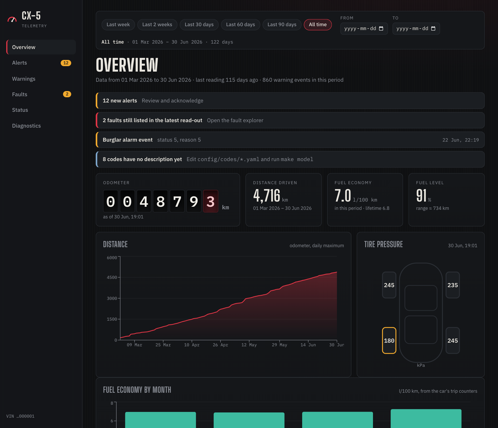
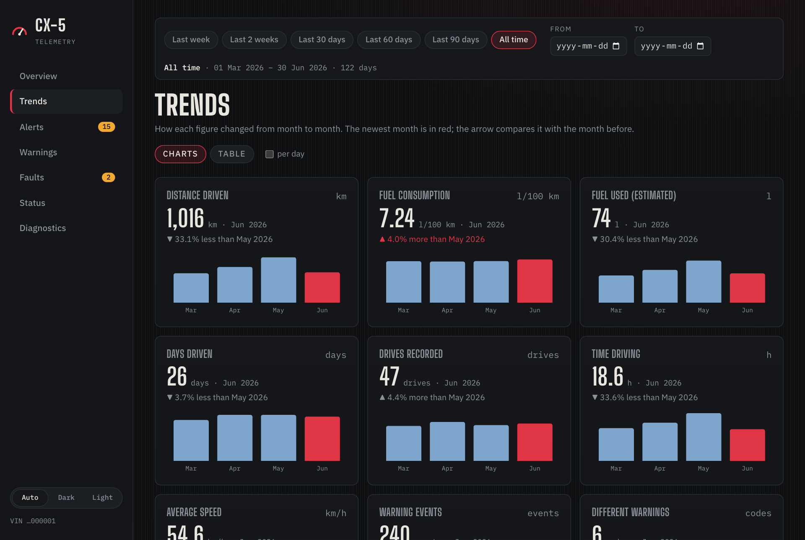
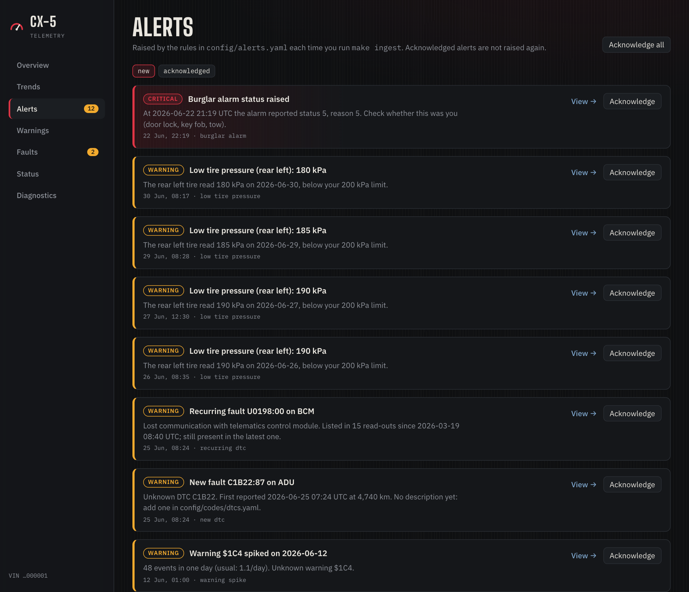
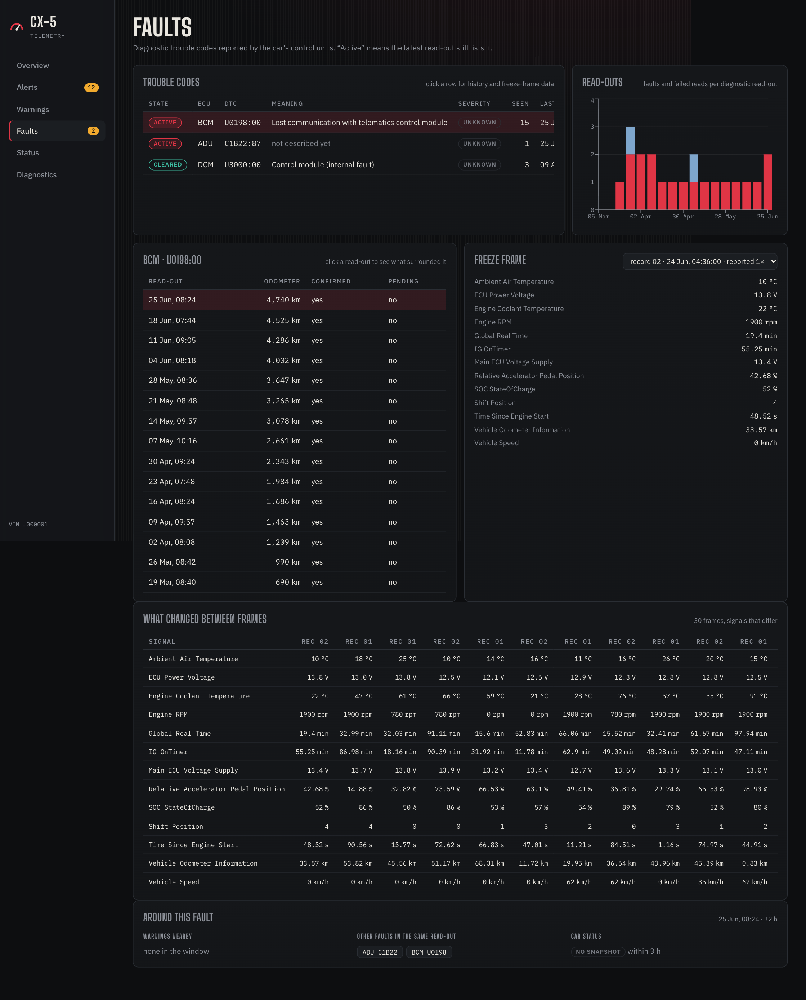
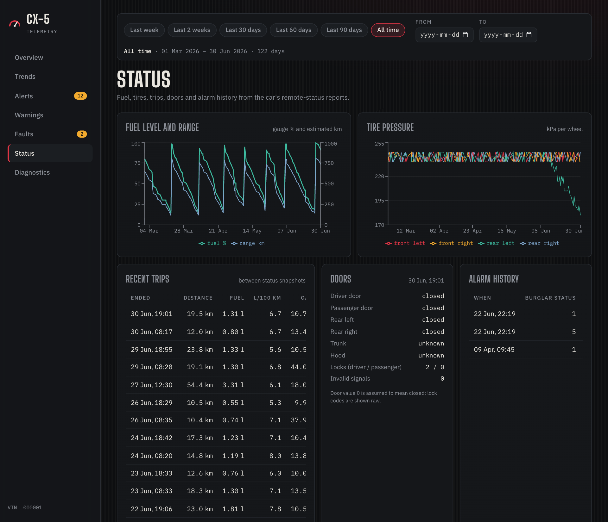
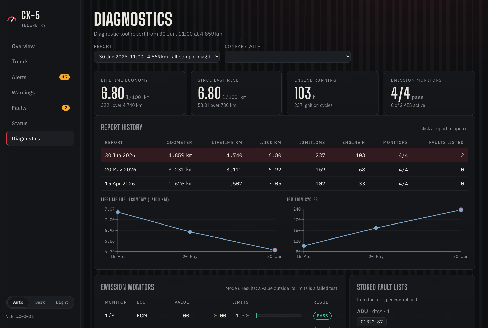
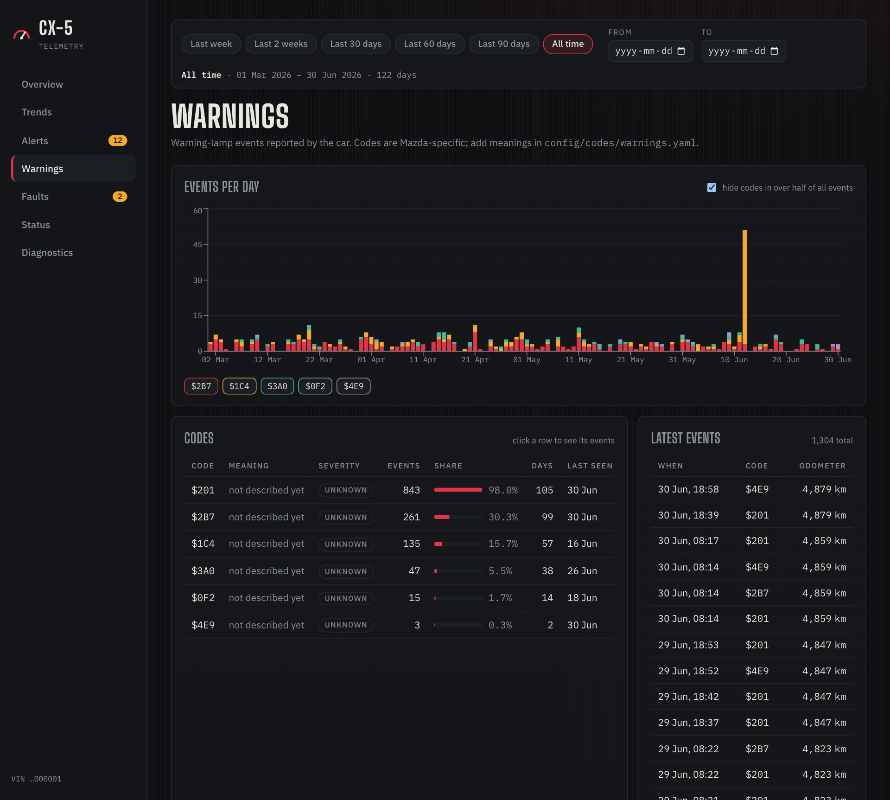

# CX-5 Telemetry

A local dashboard for the vehicle data Mazda holds about your car: warnings, fault codes, fuel
use, trips, tire pressure, doors, the alarm, and the diagnostic report that comes with the
download. It
turns the raw export files into a database, explains what they contain, and raises **alerts**
when something deserves attention (a new or recurring fault, a new or spiking warning, a slow
tire leak, an alarm event, unusually high fuel use, low fuel, an oil change coming up, or a stale
export).

Everything runs on your machine and your data stays there (see [Privacy](#privacy)).



<table>
  <tr>
    <td></td>
    <td></td>
  </tr>
  <tr>
    <td></td>
    <td></td>
  </tr>
  <tr>
    <td></td>
    <td></td>
  </tr>
</table>

*(Screenshots show the synthetic demo data in `sample_data/`, not a real car.)*

> **Unofficial.** This project is not affiliated with or endorsed by Mazda. The meaning of most
> warning and fault codes is not public, so the app ships with descriptions only where they are
> standard (SAE) and lets you add the rest. Several signal interpretations are inferred from the
> data (see [docs/data-dictionary.md](docs/data-dictionary.md)). It is a curiosity tool, not a
> substitute for a mechanic.

## Try it in two minutes (no data needed)

### 1. Install the tools

You need three tools (plus `git` to download the code). Developed on macOS; Linux should work;
on Windows use WSL (below).

| Tool | What for | macOS | Linux (Debian / Ubuntu) |
|---|---|---|---|
| [**uv**](https://docs.astral.sh/uv/getting-started/installation/) | Python and the backend's packages | `brew install uv` | `curl -LsSf https://astral.sh/uv/install.sh \| sh` |
| [**Node.js**](https://nodejs.org/) 20 or newer, with npm (tested with 20) | the dashboard (frontend) | `brew install node` | see the note below |
| **make** | runs the project's commands | `xcode-select --install` | `sudo apt install make` |

- **uv** also downloads the right Python (3.12) by itself, so you do not need to install Python.
  If you do not use Homebrew on macOS, use the Linux command above.
- **Node.js** on Linux: the distribution's package is often too old. Install a current one from
  [nodejs.org](https://nodejs.org/en/download) or with [nvm](https://github.com/nvm-sh/nvm)
  (`nvm install 20`). `npm` comes with Node.js.
- **make** on macOS comes with the Xcode command line tools (the one that ships with macOS is
  old but works). On Fedora use `sudo dnf install make`.
- **Windows**: install [WSL](https://learn.microsoft.com/windows/wsl/install) (`wsl --install` in
  an administrator PowerShell, then open the Ubuntu terminal) and follow the Linux column
  inside it. Keep the project in the Linux file system (e.g. in your WSL home folder), not under
  `/mnt/c`, and open the dashboard from your normal browser at the address below.

Check that everything is in place (open a new terminal first if you just installed something):

```bash
uv --version
node --version   # v20 or higher
make --version
git --version
```

### 2. Get the code and start the demo

```bash
git clone https://github.com/ajmcastro/mazda-data-dashboard.git
cd mazda-data-dashboard
make setup   # Python (via uv) and npm dependencies, takes a minute or two the first time
make demo    # loads the synthetic sample data, then serves it
```

Open <http://localhost:5173> in your browser. Stop the demo with Ctrl+C in the terminal.

The demo has its own database (`db/demo.duckdb`) and never touches your real one
(`db/mazda.duckdb`). You can tell you are looking at the demo by the sidebar footer, which shows
the made-up VIN `…000001`, and by data that ends on 30 June 2026.

## What is in the dashboard

| Page | What it shows |
|---|---|
| **Overview** | odometer, distance, fuel economy, fuel level, tire pressures, and the alerts that need attention |
| **Trends** | every month compared with the one before (see below) |
| **Alerts** | what the alert rules raised; acknowledge them one by one or all at once |
| **Warnings** | warning events per day, how often each code appears, and the events behind each code |
| **Faults** | trouble codes (active or cleared), their history, freeze-frame data and what else happened around them |
| **Status** | fuel and range, tire pressure per wheel, recent trips, doors and the alarm history |
| **Diagnostics** | the diagnostic report(s) in your downloads: emission monitors, stored fault lists, counters, and how they changed from one report to the next |

**Looking at a period.** The bar at the top of the Overview, Trends, Warnings, Faults and Status
pages limits everything to a *from – to* range of days (UTC, both included). Use the quick
buttons (Last week, Last 2 weeks, Last 30 / 60 / 90 days, All time) or type your own dates. Quick
ranges count back from your **newest data**, not from today, so they still make sense when your
last export is a few weeks old, and your last quick choice is remembered in the browser. The
range is kept in the address, so you can bookmark it (a link with dates always wins over the
remembered choice), and it follows you from page to page. Things that describe a *state* ignore
the range: the faults still active in the latest read-out, the alerts list and the
diagnostic-tool report.

**Trends.** Charts or a table show how each figure changed month by month: distance, fuel
consumption, warnings, faults, tire pressure and more. The change against the previous month is
green when it is good for that figure (less fuel use), red when it is bad, and grey when neither
direction is better (distance). Months the period cuts through are marked *partial*; tick
**per day** to compare them fairly with full months. A month with no data is a gap, never a zero.

**Diagnostics.** Pick any report from the **Report** list (the choice is kept in the address,
e.g. `?report=…`), see how the car's counters and fuel economy changed from one report to the next
in the report history, and use **Compare with** to see exactly which values changed between two
reports. An identical copy of a report you already loaded is recognised and skipped.

## Use your own data

### Where the data comes from: Mazda Vehicle Data

Mazda lets any driver of a Mazda download a copy of the data their connected car sends to Mazda,
through the **Mazda Vehicle Data** platform: <https://vehicledata.mazda.eu/>. The site describes
it as a way to get a copy of your vehicle's data and to choose who else may see it. The data travels
from the car over its embedded SIM card, so it applies to connected Mazdas, and what is
available depends on your vehicle's specification.

1. Open <https://vehicledata.mazda.eu/> and choose **Login** (top right).
2. No account yet? Open the **Sign up** tab (the login page's separate link for *third-party
   service providers* is not the one you want). Enter your email address to create an account;
   Mazda sends a **verification code** to it, which you enter to verify your identity. Follow
   the remaining sign-up screens; later you log in with your email address and a password.
3. **Register your vehicle.** After logging in the portal asks for your car's **VIN** and a
   **security code**. The code is not generated by the portal: you have to ask for it, either at
   a **Mazda dealer** or **directly from Mazda** (see the contact details below). You cannot
   register the vehicle without it, so ask for it first.
4. **Request the data.** Mazda prepares the report and sends you an **email when it is ready
   for download** (about an hour in one reported case). The portal also offers data
   dictionaries tailored to your vehicle, which explain the fields of your export.
5. **Download the zip file.** It contains the CSV files and the diagnostic report (a `.txt`
   file with `diag-tool` in its name). Unzip it and copy those files **directly into `data/`**
   (not into a sub-folder: only the top level of `data/` is read), then continue below.

The portal's own screens are Mazda's and may change, so they are not reproduced here.

Things to know:

- The portal describes a report as the *most recent information stored* for your vehicle. To
  follow your car over time, request a new report every month or so and keep every download
  (the diagnostic report in it is loaded too); see
  [Adding newer data later](#adding-newer-data-later).
- The files contain your VIN and may contain GPS positions. Keep them private (see
  [Privacy](#privacy)); the portal's own privacy policy and terms are linked at the bottom of
  its pages.
- Questions about the platform, your request or the security code go to Mazda, not to this
  project: use the *Contact us* link on the portal (it points to Mazda Europe's contact page),
  or your Mazda dealer. The portal names `vehicledata@mazdaeur.com` as the address of Mazda's
  Data Act team.
- This project is not affiliated with Mazda, and these steps come from the portal's public
  pages and a user's own experience. If Mazda changes the process, the portal is the authority.

### Load it

1. Put your export files in `data/` (the folder is git-ignored). Files are recognised by name:

   | Contains | File name pattern |
   |---|---|
   | warnings | `*_war-*.csv` |
   | fault read-outs | `*_dtc-h-*.csv` and `*_dtc-d-*.csv` |
   | fault freeze frames | `*_dtc-ssr-*.csv` |
   | remote vehicle status | `*_rts-*.csv` |
   | door and light status | `*_vis-*.csv` |
   | alarm status | `*_alt-*.csv` |
   | diagnostic tool report | `*diag-tool*.txt` |

2. `make ingest`: loads everything into `db/mazda.duckdb` (safe to re-run whenever you get a
   newer export) and evaluates the alert rules.
3. `make dev`: starts the API (`:8000`) and the dashboard (`:5173`).

Run `make unmapped` to see warning and fault codes that have no description yet, then add what
you learn to `config/codes/*.yaml` and run `make model`.

### Adding newer data later

You can keep adding exports as you receive them; history is never lost.

1. Put the new files in `data/`. Replacing the old files with the new ones is fine, and so is
   keeping both. Only the top level of `data/` is read, so moving older exports into
   `data/archive/` (also git-ignored) keeps them without reloading them.
2. Run `make ingest`. Only rows that are not in the database yet are added. Every row is matched
   by its transaction id or timestamp, so an export that overlaps (or repeats) earlier data
   creates no duplicates, and a cumulative export that starts from the beginning is fine too.
   The output shows how many new rows each file added (`new=0` means nothing new).
3. Open the dashboard (`make dev`). Alerts are re-evaluated; ones you already acknowledged stay
   acknowledged.

A new diagnostic `.txt` file (each download contains one) becomes an additional report on the
Diagnostics page.

Things to know:

- Your history lives in `db/mazda.duckdb`, not in `data/`. **Don't run `make reset-db`** unless
  you mean to start over: it deletes the database, including your acknowledged alerts. Copy
  `db/mazda.duckdb` somewhere safe now and then, and keep your original export files.
- Only new rows are inserted; rows already stored are never updated. If Mazda corrects an old
  value in a later export, the stored value stays. (To rebuild from scratch, run
  `make reset-db` and then `make ingest` with **all** your export files in `data/`.)
- A gap between two exports stays a gap in the charts. The "no new data" alert reminds you
  when it is time to ask for a newer export.

## Use it on your iPhone (offline, with your data on the phone)

The `mobile/` folder is the same dashboard as an offline web app: your data lives **on the phone**
and the app works without the Mac, without Wi-Fi and without any server. The Mac version above is
unaffected. It is read-only: new Mazda exports still go through `make ingest` on the Mac, then a new
data pack goes to the phone.

**1. Publish the app (once).** The repository has a GitHub Actions workflow that builds the app and
publishes it on GitHub Pages. In your copy of the repository open **Settings → Pages → Build and
deployment → Source: GitHub Actions**, then push to `main` (or run the workflow "Phone app (GitHub
Pages)" from the Actions tab). The address is `https://<your-user>.github.io/<repository>/`.
The site contains the app and the **synthetic demo data only**, never yours.

Any other static host with HTTPS works too (Netlify, Cloudflare Pages, your own server): run
`make mobile-build` and upload the folder `mobile/dist`. It must be `https://`: iOS only installs and
caches an app from a secure address.

**2. Make your data pack** on the Mac:

```bash
make ingest        # if you have new exports (see "Adding newer data later")
make mobile-pack   # writes db/mazda.cx5pack
```

**3. Move it to the phone.** AirDrop `db/mazda.cx5pack` to the iPhone and save it in **Files**
(iCloud Drive is good: it keeps the file as your backup).

**4. Install the app.** Open the site address in **Safari**, tap **Share → Add to Home Screen**, and
open the new "CX-5" icon. The first start downloads the app once (about 36 MB). When the **Data**
screen says **Works offline: yes**, you can switch Wi-Fi off.

**5. Import your data.** On the Data screen tap **Import data pack** and choose the file. Or try
**Load demo data** first. To update later, make a new pack and use **Replace with another pack**
(alerts you acknowledged on the phone stay acknowledged).

Good to know:

- **Privacy.** The pack contains your VIN, so treat it like the raw files. GPS positions are left out.
  The app makes no network request except to its own address, and your data never leaves the phone.
  Keep the pack out of git (`*.cx5pack` is ignored and `make audit` refuses it).
- **iOS may remove the stored data** after a few weeks without use or when space is low. The app asks
  Safari to keep it and tells you if it was removed; importing the pack file again takes seconds.
- **Updates.** When a newer version of the app is published, it shows an **Update** button.
- **Dark or light.** The app follows the iPhone's Appearance setting. The button at the right end of the tab bar overrides it: tap to go Auto → Dark → Light. The Mac dashboard has the same switch at the bottom of the side menu. The choice is remembered per device.
- Alerts are not re-evaluated on the phone (they come from `make ingest` on the Mac); you can
  acknowledge them on the phone.
- **Lockdown Mode** (Settings → Privacy & Security) switches off parts of Safari that this app relies on
  (the JavaScript compiler, and it can restrict WebAssembly). If the app is very slow or does not
  start, turn Lockdown Mode off for Safari or for this site. A very old iPhone will also be slow to
  start (a few seconds with real data).
- Android: the app should work in Chrome ("Install app"), but it has not been tested on a device.
- To try the app on the Mac: `make mobile-dev` and open http://localhost:5174.

## Alerts

`make ingest` (or `make alerts`) evaluates the rules in [config/alerts.yaml](config/alerts.yaml);
each alert is raised once, and an acknowledged alert is never raised again. The rules:

| Rule | Raises an alert when |
|---|---|
| new fault | a trouble code is reported for the first time |
| recurring fault | a fault is still listed in the latest read-out and has been reported repeatedly |
| new warning code | a warning code appears that was never seen before |
| warning spike | one warning code has an unusually busy day |
| burglar alarm | the alarm status is above normal |
| high consumption | a stretch of driving uses far more fuel than your average |
| low fuel | the latest fuel reading is below a threshold |
| low tire pressure | a tire reading is below a threshold (check your door-jamb sticker and set it) |
| oil change due | the car's own oil-change countdown is at or below 1,000 km (it counts in steps of 1,000 km or more) |
| no new data | the newest data is more than a few days old |

Each rule can be switched off and every threshold changed in the file (a typo is reported with a
clear error). Event rules only look at the most recent `lookback_days` of data, so the first run
does not flood you with history.

For a macOS notification when new alerts appear, set `notifications: desktop: true` in the same
file (or run `cd backend && uv run python -m mazda_dash.alerts --notify`).

## Commands

| Command | What it does |
|---|---|
| `make setup` | install backend and frontend dependencies |
| `make ingest` | load `data/` into `db/mazda.duckdb`, rebuild the views, evaluate alerts |
| `make alerts` | evaluate `config/alerts.yaml` only |
| `make model` | reload `config/codes/*.yaml` and recreate the SQL views |
| `make unmapped` | list codes in your data that have no description |
| `make dev` | run API and dashboard (`make api` / `make web` for just one of them) |
| `make demo` | the same with the synthetic sample data (`make demo-ingest` only loads it) |
| `make sample-data` | regenerate `sample_data/` (deterministic) |
| `make types` | regenerate the frontend's TypeScript types from the API schema |
| `make test` / `make lint` | backend and frontend tests / checks |
| `make mobile-pack` | export your database as `db/mazda.cx5pack` for the phone app |
| `make mobile-dev` / `make mobile-build` | run / build the phone app (`mobile/`) with the demo data |
| `make mobile-test` | check that the phone app's TypeScript engine answers exactly like the Python API |
| `make format` | format the backend code |
| `make profile` | per-file data profiling reports in `docs/profile/` |
| `make audit` | check for private values before publishing (see [Privacy](#privacy)) |
| `make reset-db` | **delete** `db/mazda.duckdb`, including acknowledged alerts |
| `make clean` | remove generated profiling reports and tool caches |

## How it works

```
data/*.csv, *.txt ──ingest──▶ DuckDB tables ──views + code lookups──▶ FastAPI ──▶ React dashboard
                                   │                 ▲
                                   └──alert rules────┘  (config/alerts.yaml → alerts table)
```

- `backend/src/mazda_dash/ingest`: parsers for each file kind (idempotent; sentinel values such
  as `2147483647` become NULL).
- `backend/src/mazda_dash/model`: lookup tables from `config/codes/` and the SQL views the API
  and alerts read ([view catalogue](docs/data-dictionary.md)).
- `backend/src/mazda_dash/alerts`: one detector per rule; each alert is raised once.
- `backend/src/mazda_dash/api`: read-only JSON API (plus acknowledging alerts) and the monthly
  figures for the Trends page.
- `frontend/`: Vite, React, TypeScript, Recharts. Types are generated from the API's OpenAPI
  schema.
- `mobile/`: the same pages as an offline phone app. DuckDB runs in the browser (WebAssembly) on a
  data pack exported by `make mobile-pack`, and a TypeScript port of the API answers the pages;
  contract tests keep it identical to the Python API.

[PLAN.md](PLAN.md) has the design decisions and the milestones this was built in.

## Privacy

Vehicle exports contain your VIN, and may contain GPS positions. `data/`, `db/` and `*.duckdb`
are git-ignored, and nothing you load is sent anywhere: the dashboard talks only to the API on
your own machine. The one outside request is the page fonts, which the browser fetches from
Google Fonts (no data is sent, and the dashboard still works without them). The phone app bundles
its fonts and makes no outside request at all. Data packs (`*.cx5pack`, which hold the VIN) are
git-ignored too.

If you fork this project, or publish your own copy, run:

```bash
make audit
```

It reads the private values (VINs, positions) from your `data/` folder and searches every file
git would publish **and the whole git history** for them, and lists the commit author emails
for review. The tests and the sample data use only made-up values.

## Troubleshooting

- **"Database … not found - run `make ingest` first"**: you have not loaded any data yet. Put
  your files in `data/` and run `make ingest`, or try `make demo`.
- **"Database is busy" when acknowledging an alert**: `make ingest` is running and holds the
  database; wait for it to finish.
- **Charts are empty or say "No data in this period"**: look at the period bar and press
  **All time**.
- **Port 8000 or 5173 already in use**: stop the other program using it, then run `make dev`
  again.
- **`npm install` fails**: use `make setup`; `frontend/.npmrc` sets the option this project's
  dependencies need.

## Development

```bash
make test          # pytest + vitest
make lint          # ruff, oxlint, tsc
make mobile-test   # phone app: contract tests against the Python API, types
```

CI runs the same checks (plus a format check and production builds), verifies that the generated
types and sample data are up to date, replays the Python API's answers against the phone app's
engine, and runs the privacy audit. The phone app is published by `.github/workflows/pages.yml`.
When you change an API endpoint, change its twin in `mobile/src/engine/` in the same commit. See [CLAUDE.md](CLAUDE.md) for a tour of the
code for contributors and coding assistants.

## License

[MIT](LICENSE)
